# Thorium Subcritical Reactor Study (OpenMC)

A reactor physics learning project built with **OpenMC** and **Python**. I started with a single uranium fuel pin, scaled up to full 17x17 assemblies, then built a thorium assembly that stays below critical and is driven by an external 14.1 MeV neutron source. From there I tracked how the fuel changes over a year and how sensitive the design is to temperature, water density and pin spacing.

Every step is a script that saves its plots to `results/figures/`, and every result is checked against simple theory.

> Background theory, equations, and a glossary live in [information.md](information.md).

All models are simplified 2D lattices with water moderation and reflective edges. This is a learning project, not a model of any real reactor design.

---

## Key results

| Result | Value |
|--------|-------|
| Driven assembly, simulated multiplication | 28.4x |
| Driven assembly, 1/(1 - k) prediction | 22.4x |
| k from detectors near the source / far from it / true | 0.930 / 0.951 / 0.955 |
| Driven depletion over one year, multiplication | 28.3x to 11.3x |
| Driven depletion over one year, power per pin | 200 to 75 W/cm |
| Pa-233 at end of fixed-power pin depletion | about 19% of U-233 inventory |
| Water density lowered, k | 0.970 to 0.993 |
| Doppler coefficient | about -2.9 pcm/K |

---

## Steps

### 1. Cross sections

Fission and capture cross sections for U-235, U-233 and Th-232. Th-232 barely fissions with slow neutrons, which is why thorium fuel needs some U-233 (or an outside neutron source) to get going.

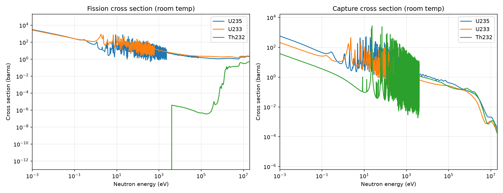

### 2. Pin cell

A single 3% enriched uranium fuel pin in water with reflective edges. I checked that k-effective settles after the inactive batches and looked at the neutron energy spectrum.

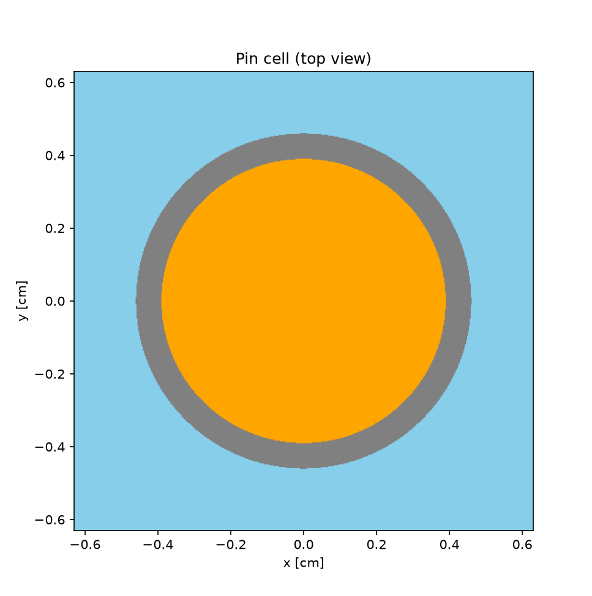
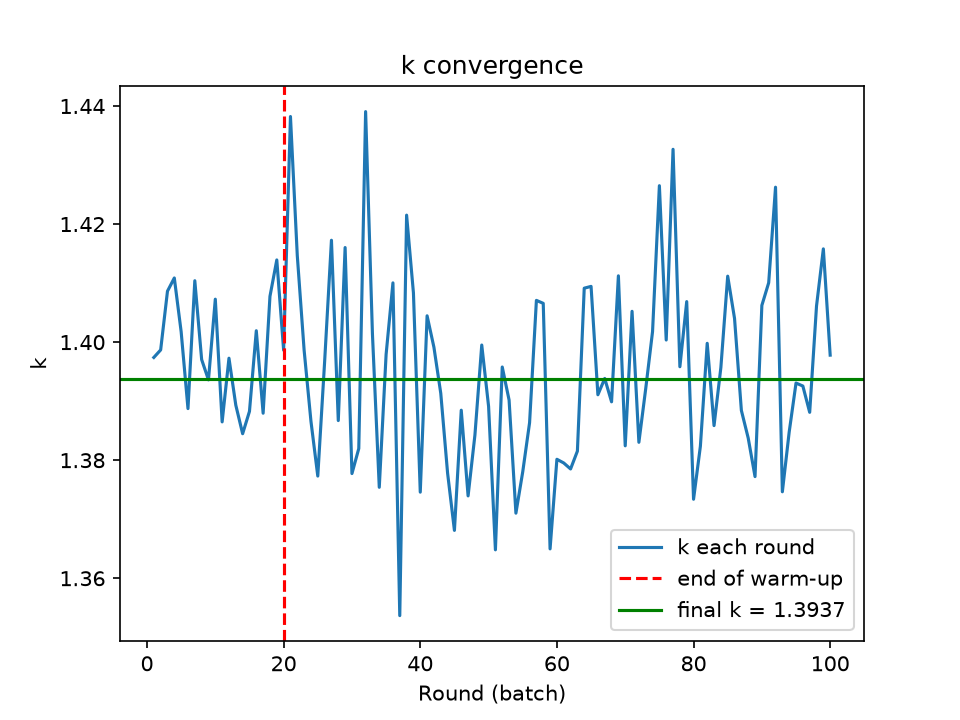
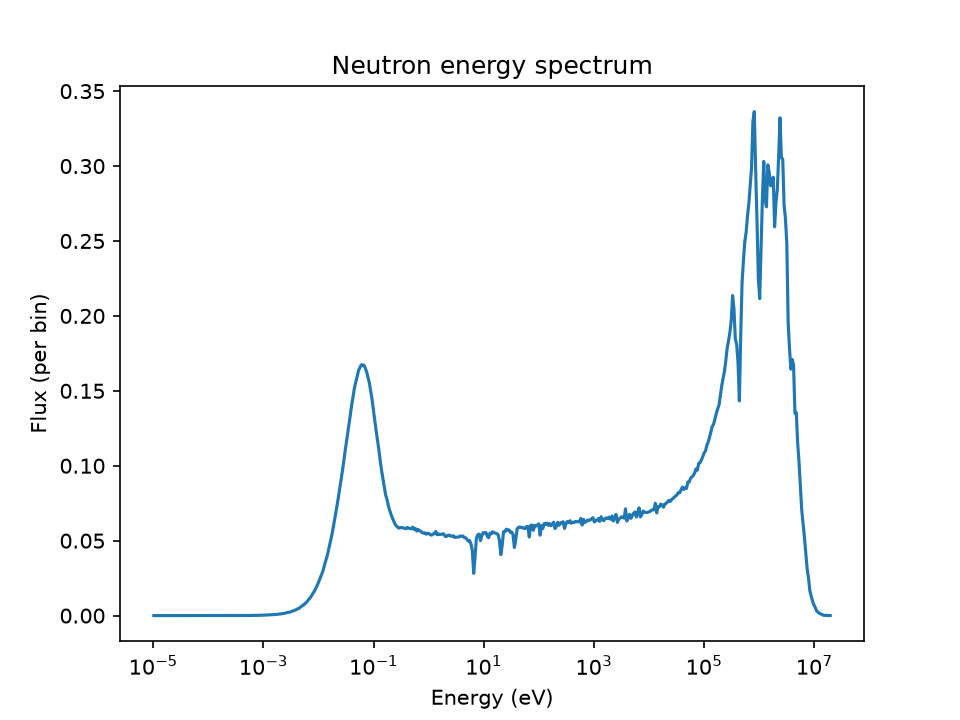

### 3. Assembly

A 17x17 assembly with 25 water holes, run once with uranium fuel and once with thorium fuel (ThO2 with 5% U-233). The heatmaps show flux and power per rod side by side.

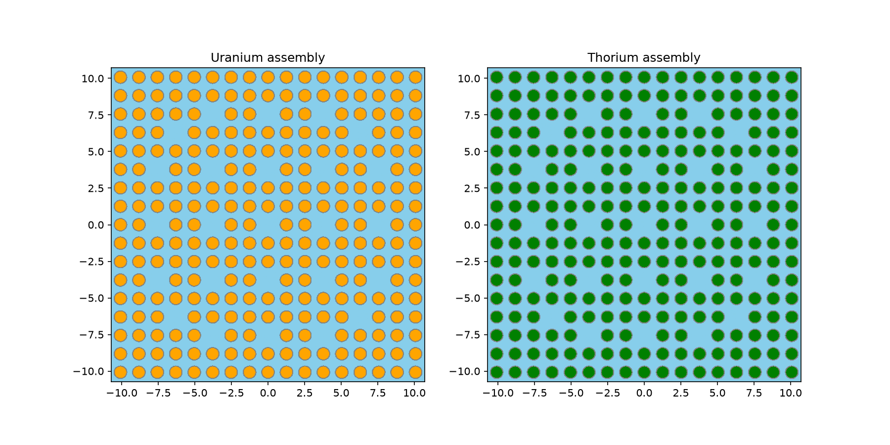
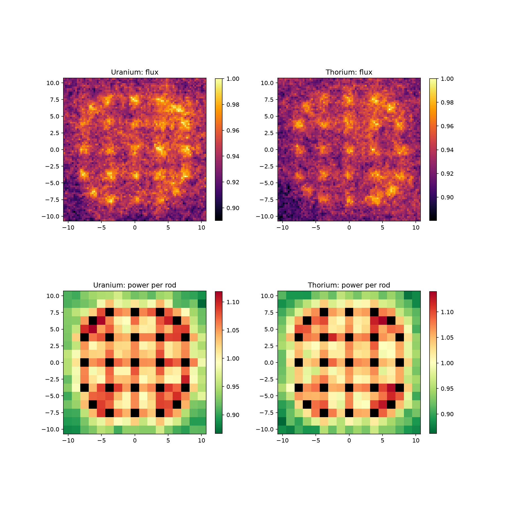

### 4. Driven subcritical assembly

The thorium assembly with only 1.3% U-233, so it sits below critical. A 14.1 MeV point source in the center drives it. The simulated multiplication (28.4x) is higher than 1/(1 - k) predicts (22.4x). The simple formula assumes source neutrons behave like fission neutrons. 14 MeV neutrons can cause fast fission in Th-232 and (n,2n) reactions, which adds extra neutrons the formula doesn't count.

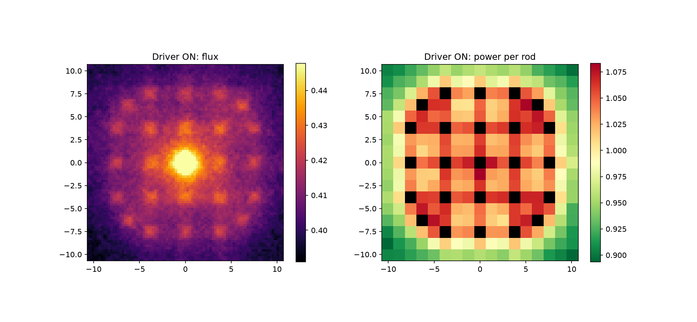
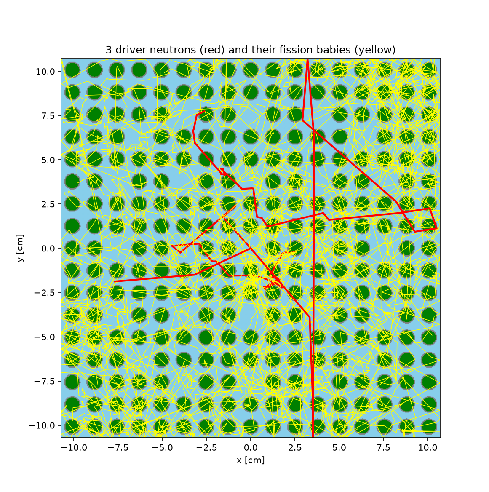

### 5. Detector study

Four detectors placed in water holes at different distances from the source, used to estimate k from their readings over time. Detectors near the source underestimated k (0.930 near vs 0.951 far vs 0.955 true), because close to the source the flux shape is set by the source instead of the assembly itself.

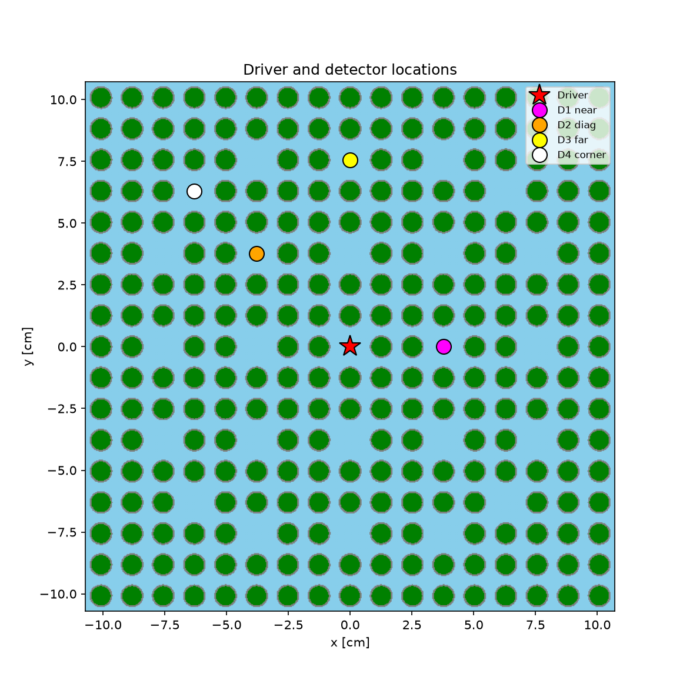
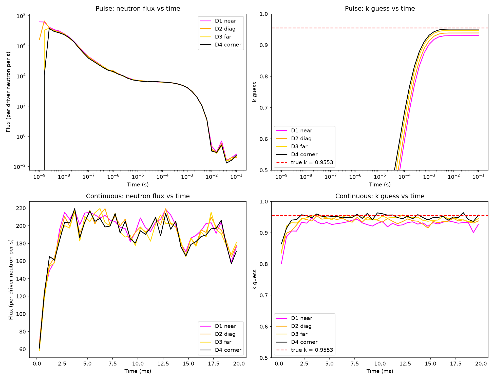

### 6. Depletion

Two cases, both over one year:

- **Fixed-power pin:** a single thorium pin at 200 W/cm. U-233 builds up from Th-232, and Pa-233 (the step in between) reaches about 19% of the U-233 inventory.
- **Driven assembly:** the driver source is held constant instead of the power. As the fuel burns, k drops, so multiplication falls from 28.3x to 11.3x and power falls from 200 to 75 W/cm.

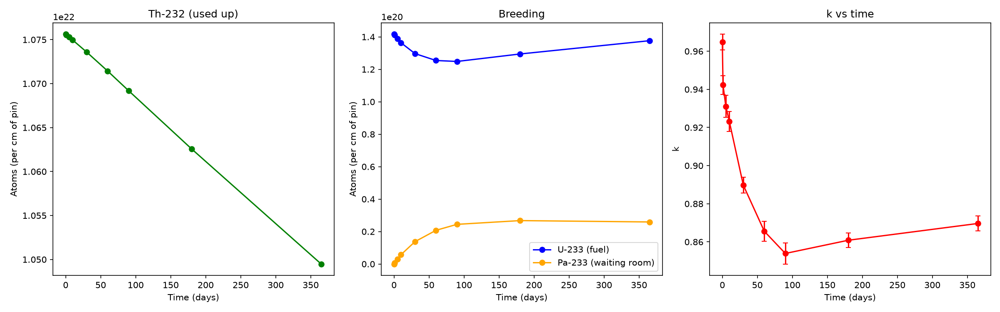
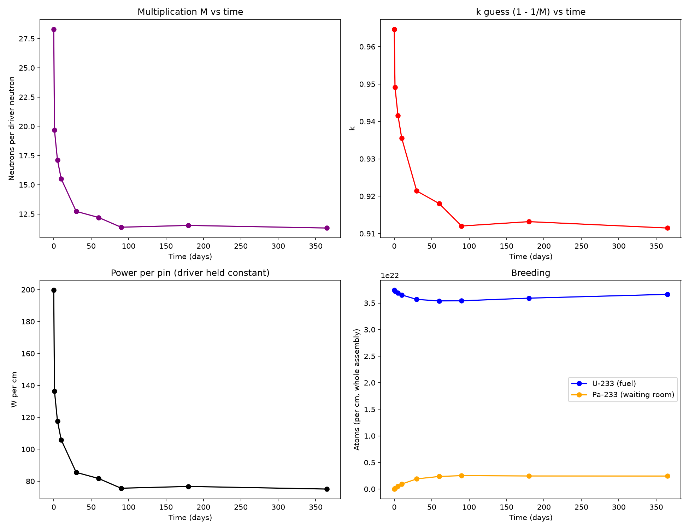

### 7. Sensitivity

Pin cell sweeps of fuel temperature, water density and pin pitch. The lattice is over-moderated, so removing water raises k (0.970 to 0.993). The Doppler coefficient is about -2.9 pcm/K.

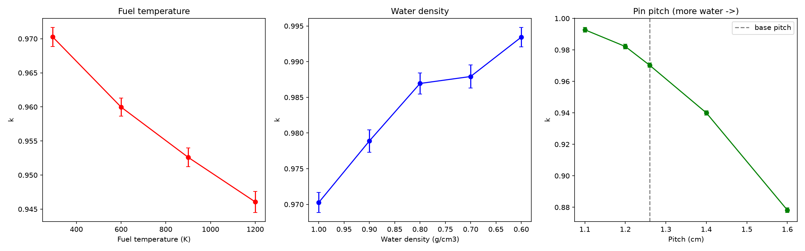

---

## Verification checks

- Pure Th-232 is not fissile, so thorium fuel only gets close to critical with U-233 added.
- Source multiplication should roughly follow M = 1/(1 - k). It does, with a known gap from the 14 MeV source (see step 4).
- U-233 should rise over time as Th-232 is consumed, with Pa-233 building up in between. It does.
- Higher fuel temperature should lower k (negative Doppler coefficient). It does.

---

## Limitations

- The models are 2D lattices with reflective edges, so there is no leakage from a finite core.
- Materials and geometry are simplified and water-moderated. This is not a model of any real reactor design.
- The driver is a point source of 14.1 MeV neutrons. The accelerator and target that would produce them are not modeled.

---

## Layout

```
thorium-subcritical-reactor-study/
├── README.md
├── information.md
├── environment.yml
├── 01_cross_sections/plot_xs.py
├── 02_pin_cell/pin_cell.py
├── 03_assembly/assembly.py
├── 04_subcritical/
│   ├── subcritical.py        driven assembly, heatmaps, particle tracks
│   └── driver_time.py        detector study
├── 05_depletion/
│   ├── depletion.py          fixed-power pin depletion
│   ├── plot_depletion.py     plots for the pin case
│   └── depletion_driver.py   driven assembly depletion
├── 06_sensitivity/sensitivity.py
└── results/figures/
```

Simulation outputs go to `<step>/output/` and are not committed.

---

## Setup

**Requirements**
- Linux, macOS, or Windows with WSL (Ubuntu)
- Conda (Anaconda or Miniconda)

**1. Create the environment**
- Recreate the env with `conda env create -f environment.yml`
```bash
conda activate openmc-env
```

**2. Get nuclear data**
- Download the ENDF/B-VIII.0 HDF5 cross-section library from the official OpenMC data page
- Point OpenMC to it:
```bash
export OPENMC_CROSS_SECTIONS=/path/to/cross_sections.xml
```
- For depletion, also download the depletion chain file and save it as `~/nuclear_data/chain_endfb80_pwr.xml`

**3. Run a step**

Run scripts from the repo root, for example:
```bash
python 02_pin_cell/pin_cell.py
```
Some steps take a long time and use a lot of memory.

---

## Tools

- **OpenMC** for Monte Carlo neutron transport
- **NumPy** and **Matplotlib** for processing and plots
- **Git** for version control

---

## Author

Lucas Hoskin
